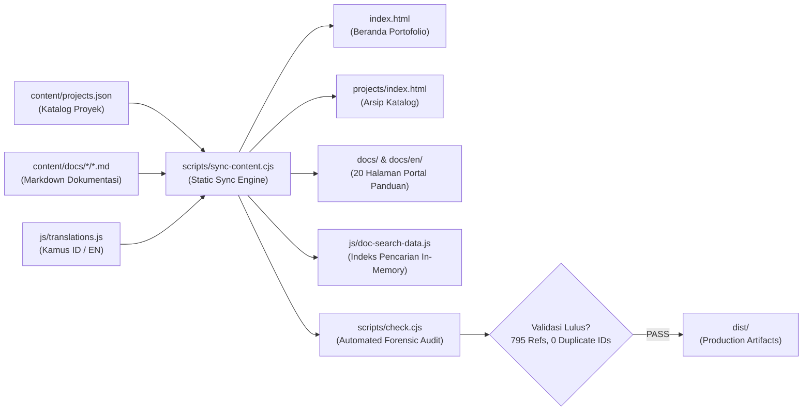

# 🌌 Zelyff — Developer & Server Admin Portfolio

<div align="center">

[](https://zelyff.github.io/portofolio/)
[]()
[-10b981?style=for-the-badge&logo=checkmarx&logoColor=white)]()
[]()
[]()

**Portofolio resmi dan pusat dokumentasi sistem milik Zelyff.**  
*Server Administrator & Developer di AlamNusa RPG • High-Performance Systems • Zero-Dependency Architecture*

[🌐 Live Demo](https://zelyff.github.io/portofolio/) •
[👤 Profil Pengembang](#-tentang-zelyff) •
[🏛️ Arsitektur Website](#️-arsitektur-teknis-portofolio) •
[💎 Proyek Unggulan](#-proyek-unggulan-alamnusa-ecosystem) •
[📁 Struktur Repositori](#-struktur-repositori) •
[🛠️ Menjalankan & Membangun](#️-panduan-pengembangan--build) •
[🛡️ Audit Forensik](#-audit-forensik--jaminan-kualitas)

---

</div>

## 📌 Ringkasan Proyek

Repositori ini memuat kode sumber dari **website portofolio personal dan portal dokumentasi interaktif Zelyff**. 

Website ini dirancang bukan sekadar sebagai halaman etalase statis biasa, melainkan sebagai sebuah platform dokumentasi dwibahasa (**Indonesia & Inggris**) berkinerja tinggi yang ditenagai oleh *static generation engine* berbasis Node.js murni (**zero runtime dependencies**). Seluruh data proyek, dokumentasi teknis, dan visual interaktif terhubung langsung ke satu sumber kebenaran (*single source of truth*) di `content/projects.json`.

---

## 👤 Tentang Zelyff

* **Peran Utama**: Server Administrator & Systems Developer di **AlamNusa** (Komunitas & Server Minecraft MMORPG Season 7, aktif sejak Oktober 2025).
* **Filosofi Teknis**: *"Membangun, bereksperimen, dan belajar lewat sistem yang nyata."*
* **Fokus Utama**:
  * **Arsitektur Server Minecraft**: Optimasi performa Paper/Purpur 1.21.4+, pencegahan lag tick, integrasi entitas Display modern, dan mitigasi exploit inventory.
  * **Rekayasa Perangkat Lunak Java**: Pembuatan plugin kustom menggunakan Java 21, State Machine deterministik, sinkronisasi stat MMOItems/MythicLib, serta arsitektur persistensi *Zero Data Loss*.
  * **Kecerdasan Buatan (AI) & Bot Komunitas**: Pengembangan bot asisten Discord generasi baru dengan arsitektur Retrieval-Augmented Generation (RAG) multi-model (Google Gemini 3.6 Flash / 3.5 Flash Lite) dan visi multimodal.
  * **Web Development**: Web statis modern, estetika minimalist terinspirasi antarmuka GitHub, tipografi presisi, dan performa akses instan.

---

## 🏛️ Arsitektur Teknis Portofolio

Situs portofolio ini dibangun dengan filosofi **kecepatan maksimal, aksesibilitas tinggi, dan nol bloatware**:



### Keunggulan Rekayasa Web:
1. **Zero-Dependency Static Engine**: Generator dokumen dan sinkronisasi halaman bekerja menggunakan modul bawaan Node.js (`fs`, `path`, `vm`, `assert`). Tidak membutuhkan instalasi ribuan paket `node_modules` hanya untuk mengompilasi halaman.
2. **Instant Anti-FOUC Theme Switcher**: Script inisialisasi tema `js/theme.js` dieksekusi secara sinkron di tag `<head>`, menjamin tidak ada kedipan warna (*Flash of Unstyled Content*) saat berganti antara mode gelap dan terang.
3. **Pencarian Dokumentasi Client-Side Instan**: Pencarian artikel pada portal dokumentasi membaca indeks tokenized `js/doc-search-data.js` secara langsung di memori browser dengan pencocokan instan tanpa latensi API backend.
4. **Sistem Dwibahasa (ID / EN) Penuh**: Dukungan penuh bahasa Indonesia dan Inggris untuk seluruh antarmuka beranda, arsip katalog, dan 20 halaman dokumentasi teknis mendalam.
5. **Tipografi & Desain GitHub Klasik**: Mengombinasikan font modern Google Fonts (*Space Grotesk*, *Inter*, dan *JetBrains Mono*) dengan kartu status Mac Terminal interaktif yang menampilkan waktu lokal WIB secara live.
6. **Keamanan Sanitasi XSS Berlapis**: Parser Markdown kustom (`scripts/lib/markdown.cjs`) dan renderer kartu proyek menerapkan escaping karakter ketat terhadap tag `<script>`, atribut injeksi, dan skema URL berbahaya.

---

## 💎 Ikhtisar Proyek Unggulan

Sistem dan perangkat lunak yang dibangun dari kebutuhan nyata komunitas dan server AlamNusa:

| Proyek | Kategori | Stack Utama | Status & Akses | Dokumentasi |
| :--- | :--- | :--- | :--- | :--- |
| **NusaCooking** | Minecraft Plugin | Java 21 · Paper 1.21.4+ · Display Entities | Selesai · Privat AlamNusa | [Buka Panduan](docs/nusacooking/) |
| **NusaInv** | Minecraft Plugin | Java 21 · Paper 1.21.4+ · MMOItems / MythicLib | Selesai · Privat AlamNusa | [Buka Panduan](docs/nusainv/) |
| **NusaSkBlocker** | Server Utility | Java 21 · Paper 1.21.4+ · AuraSkills 2.2+ | Selesai · Privat AlamNusa | [Buka Panduan](docs/nusaskblocker/) |
| **GogoAssistant** | Discord AI Bot | Node.js 22 · discord.js · Gemini AI Cascade | Aktif · Komunitas | [Buka Panduan](docs/gogoasisstant/) |

> 💡 *Untuk detail arsitektur lengkap, panduan teknis, dan alur sistem tiap proyek, jelajahi langsung melalui portal dokumentasi di [docs/](docs/) atau via antarmuka web [zelyff.github.io/portofolio/docs/](https://zelyff.github.io/portofolio/docs/).*


---

## 📁 Struktur Repositori

```text
portofolio/
├── .gitignore                   # Sanitasi Git (dist, cache, env, backup)
├── index.html                   # Halaman beranda portofolio utama (bilingual markup)
├── README.md                    # Dokumentasi resmi repositori ini
│
├── .project/                    # Arsip dokumentasi teknis mendalam dari 4 sistem utama
│   ├── READMEnusa sk blockker.md# Arsitektur & audit lengkap NusaSkBlocker
│   ├── READMEny NusaCooking.md  # Arsitektur & audit lengkap NusaCooking
│   ├── readmenya NusaInv.md     # Arsitektur & audit lengkap NusaInv
│   └── readmenya gogoassistant.md # Arsitektur & audit lengkap GogoAssistant
│
├── content/                     # SUMBER KONTEN UTAMA (Single Source of Truth)
│   ├── projects.json            # Katalog master proyek, status, tag, dan rute panduan
│   └── docs/                    # Berkas sumber Markdown dwibahasa
│       ├── gogoasisstant/       # overview.id.md, overview.en.md, komunitas.*.md
│       ├── nusacooking/         # overview.id.md, overview.en.md, alur-memasak.*.md
│       ├── nusainv/             # overview.id.md, overview.en.md, equipment.*.md
│       └── nusaskblocker/       # overview.id.md, overview.en.md, aturan-dunia.*.md
│
├── docs/                        # Hasil kompilasi portal dokumentasi publik
│   ├── index.html               # Portal panduan Indonesia
│   ├── en/index.html            # Portal panduan Inggris
│   ├── gogoasisstant/           # Halaman panduan ter-generate (ID & EN)
│   ├── nusacooking/
│   ├── nusainv/
│   └── nusaskblocker/
│
├── projects/                    # Halaman arsip seluruh proyek
│   └── index.html               # Katalog lengkap dengan filter dinamis
│
├── css/                         # Arsitektur CSS Vanilla Modular
│   ├── main.css                 # Token desain, variabel warna HSL, reset dasar
│   ├── components.css           # Komponen tombol, kartu status, navigasi, badge
│   ├── responsive.css           # Layout breakpoint dan drawer mobile
│   ├── polish.css               # Efek ambient, glow pencahayaan, dan grid kontur
│   └── pages.css                # Layout dokumentasi, sidebar, tabel, dan pencarian
│
├── js/                          # Arsitektur JavaScript ES6+
│   ├── theme.js                 # Anti-FOUC theme detector
│   ├── translations.js          # Kamus terjemahan antarmuka (ID & EN)
│   ├── projects.js              # Renderer kartu proyek, flow preview, & console
│   ├── main.js                  # Interaksi beranda, jam WIB, scroll & filter
│   ├── docs.js                  # Handler pencarian lokal, sidebar, & TOC
│   ├── project-data.js          # Generated window.PORTFOLIO_DATA
│   └── doc-search-data.js       # Generated window.DOC_SEARCH_INDEX
│
├── scripts/                     # Generator & Verifikasi Otomatis (Node.js 18+)
│   ├── sync-content.cjs         # Sinkronisasi konten beranda, generate 20 halaman docs
│   ├── check.cjs                # Audit statis mendalam (link, H1, XSS, translasi)
│   ├── check-evolution.cjs      # Sandbox test untuk pengujian penambahan proyek
│   ├── build.cjs                # Generator folder rilis publik (dist/)
│   ├── generated-pages.json     # Manifest halaman ter-generate
│   └── lib/
│       ├── markdown.cjs         # Parser markdown aman bersanitasi
│       └── pages.cjs            # Generator shell HTML dwibahasa
│
└── assets/                      # Aset gambar, ikon, dan vektor grafis
    ├── contours.svg             # Tekstur latar belakang garis kontur
    ├── og-image.png             # Banner Open Graph & Twitter Cards
    └── icons/                   # Favicon SVG dan ikon sistem
```

---

## 🛠️ Panduan Pengembangan & Build

Website ini siap dijalankan secara lokal tanpa perlu mengunduh package manager atau menjalankan `npm install`.

### 1. Menjalankan Situs Secara Lokal
Cukup buka berkas `index.html` langsung di browser Anda, atau gunakan ekstensi live server ringan:
```bash
# Contoh menggunakan npx serve (opsional)
npx serve .
```

### 2. Menyinkronkan Konten & Menghasilkan Halaman
Ketika Anda memperbarui `content/projects.json` atau mengedit dokumen di `content/docs/`, jalankan:
```bash
node scripts/sync-content.cjs
```
*Skrip ini akan memperbarui kartu beranda, menyinkronkan data proyek, mengompilasi 20 halaman HTML panduan (ID & EN), serta memperbarui indeks pencarian in-memory.*

### 3. Menjalankan Pengujian Forensik & Integritas
Sebelum melakukan commit atau push ke GitHub, verifikasi integritas kode dengan:
```bash
node scripts/check.cjs
```
Output yang diharapkan:
```text
PASS: 4 data-driven projects; 20 HTML pages; 795 local references; counts, ID/EN, Markdown safety and search index.
```

### 4. Menguji Evolusi Proyek Terisolasi
Untuk menguji penambahan proyek atau kategori baru tanpa memengaruhi berkas asli:
```bash
node scripts/check-evolution.cjs
```

### 5. Membangun Direktori Distribusi (`dist/`)
Untuk menghasilkan bundel rilis siap pakai ke layanan hosting dengan output folder:
```bash
node scripts/build.cjs
```
Folder `dist/` akan berisi seluruh halaman publik yang bersih dan siap diunggah.

---

## 🌐 Panduan Deployment (GitHub Pages)

### Deployment dari Root Repository
Repositori ini telah disiapkan untuk **GitHub Pages** langsung dari branch `main`:
1. Masuk ke **Settings** ➔ **Pages** pada repositori GitHub Anda.
2. Di bagian **Build and deployment**, pilih **Source**: `Deploy from a branch`.
3. Pilih branch `main` dan folder `/(root)`.
4. Simpan, dan situs Anda akan aktif di `https://zelyff.github.io/portofolio/`.

### Menggunakan Custom Domain / URL Khusus
Jika Anda mempublikasikan repositori ini di domain kustom atau URL berbeda, atur variabel lingkungan sebelum menjalankan sinkronisasi:
```bash
# Windows PowerShell
$env:PORTFOLIO_SITE_URL="https://namadomainanda.com/"
node scripts/sync-content.cjs

# Linux / macOS
PORTFOLIO_SITE_URL="https://namadomainanda.com/" node scripts/sync-content.cjs
```

---

## 🛡️ Audit Forensik & Jaminan Kualitas

Sistem portofolio ini dibangun dengan disiplin rekayasa yang ketat:

| Kriteria Audit | Status | Metodologi & Hasil |
| :--- | :---: | :--- |
| **Integritas Link Lokal** | ✅ **100% Valid** | 795 tautan internal dan anchor antarhalaman diverifikasi tanpa satu pun link rusak (*dead link*). |
| **Hirarki Heading SEO** | ✅ **100% Sesuai** | Setiap halaman tepat memiliki satu tag `<h1>` yang unik dan relevan. |
| **Pencegahan Injeksi XSS** | ✅ **Hardened** | Renderer kartu dan Markdown menolak tag `<script>`, escaping atribut, dan skema `javascript:`. |
| **Simetri Terjemahan** | ✅ **100% Sinkron** | Seluruh kunci kamus terjemahan `id` dan `en` pada `translations.js` identik secara simetris. |
| **Zero Runtime Bloat** | ✅ **0 Dependencies** | Berjalan mulus di browser modern tanpa JavaScript runtime framework eksternal. |
| **Aksesibilitas & Gerak** | ✅ **A11y Compliant** | Mendukung keyboard navigation, pembaca layar ARIA, kontras tinggi, dan `prefers-reduced-motion`. |

---

## 🤝 Kontak & Komunitas

* **Pengembang**: **Zelyff**
* **Discord**: [Buka Profil Discord (ID: 1375486504373190776)](https://discord.com/users/1375486504373190776)
* **GitHub**: [@Zelyff](https://github.com/Zelyff)
* **Server Komunitas**: AlamNusa Minecraft Server & Community

---

<div align="center">

<sub>Dikelola dengan penuh ketelitian oleh Zelyff • Masih belajar, masih membangun.</sub>

</div>
